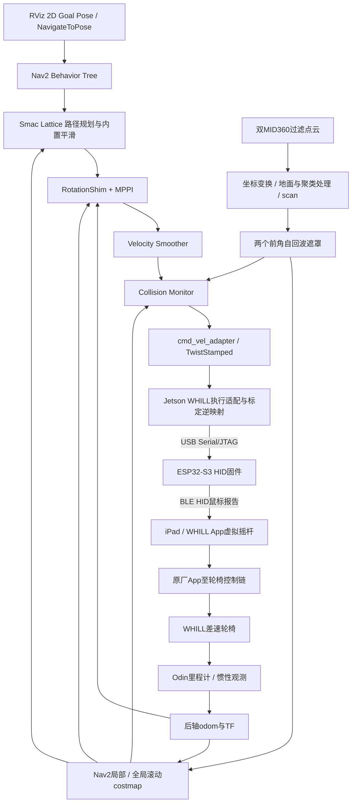

# WHILL 轮椅导航系统：架构与工程路线

更新：2026-11-03。本文描述当前保留的原生Nav2导航系统，从非EDU底盘接入到传感器、速度接口与规划执行。具体低层协议见[单片机、蓝牙与速度执行](LOW_LEVEL_CONTROL.md)，后续汇报素材见[配图框架](PRESENTATION_FRAMEWORK.md)。

## 1. 项目目标与平台条件

平台是一台非EDU版本WHILL差速轮椅。两个后轮差速驱动，前部由被动万向轮支撑；可以通过左右轮差速实现原地旋转。当前工程没有使用轮椅原生开发版底盘SDK直接发送轮速，而是复用已有iPad/WHILL App的控制入口，通过ESP32模拟鼠标拖动App虚拟摇杆，将ROS速度目标接入现有车辆。

Jetson承担感知、坐标转换、导航规划和上位机控制适配。两个倒装Livox MID360提供障碍点云；Odin设备提供里程计/惯性与定位相关输入。当前导航采用Odin输出，不另起AMCL来替换定位。`base_link`定义在后轴中心，x向前、y向左、z向上；安装在座椅附近的设备坐标不直接充当底盘运动中心。

工程工作的核心是打通并明确以下接口：

- 从粗粒度方向键/鼠标位移，演进为可接收连续`cmd_vel`的执行适配。
- 将传感器观测、后轴位姿和真实车体轮廓统一到导航使用的坐标体系。
- 保持规划、控制、速度平滑、碰撞监控和底盘执行各自的职责边界。
- 保存可追溯的源码、参数、标定来源和验证记录，便于后续接入新的上层意图。

## 2. 从上层到实车的完整链路

ESP32至iPad的链路是本工程实现的BLE HID。App至轮椅的原厂控制链不在当前源码中实现，不能把这两段统称成“ESP32直接蓝牙驱动电机”。

反向反馈主要来自Odin；当前不是“电机编码器→ESP32→Jetson”的轮速反馈链。上层导航可以依据里程计修正运动，但底层速度映射本身没有实现速度PID。

## 3. 工程演进：从离散方向到连续速度接口

### 阶段A：建立可工作的原有控制入口

已有接口通过串口向ESP32发送方向字符、鼠标按下/松开、归位和查询指令。ESP32把这些指令转换成BLE鼠标报告，在iPad上完成指针移动和拖动。该阶段首先解决“如何通过现有App让轮椅接受外部控制”。

方向字符代表的是鼠标位移增量，不是直接的车轮线速度。持续按键会累积指针位置；轮椅速度由App摇杆偏移、App设置及车辆响应共同决定。因此只有方向键接口，还不足以直接满足Nav2的连续速度输出。

### 阶段B：建立App坐标与后轴速度的关系

先标定屏幕归位参考、摇杆中心和方向锚点，再记录不同输入下的Odin后轴运动。由数据建立App输入到(v, omega)的稳态模型，并实现逆映射：上层给速度，下层求对应的摇杆位置。

该模型区分前进与倒退增益，左右转向采用对称模型。它是数据标定的执行映射，不是车辆动力学全模型，也不包含独立速度闭环。

### 阶段C：细化传输分辨率

保留原有方向/按键协议和报告顺序，增加带校验的精细相对位移帧。上位机可发送小于一个旧方向步长的位移，减少只用粗步长时的控制量化。连续速度目标仍通过离散HID报告传输；坐标分辨率提升不等于实车速度精度自动按相同比例提高。

### 阶段D：接入原生Nav2

Nav2输出(v, omega)，适配器加上时间戳和车体坐标约定，WHILL执行节点转换为App目标位置，通过已有按下/拖动/释放路径执行。地图、规划与避障由上层负责，单片机不运行Nav2、不维护障碍地图，也不自行选择绕行方向。

## 4. 传感器、坐标与观测地图

两台MID360安装时倒装；既有外参TF负责姿态和位移转换，不能在点云处理里再次人为翻转。地面处理、近车聚类和原有自过滤在既有传感器链中完成，再生成导航使用的二维scan。

Odin的安装位置与后轴中心不同，后轴里程计需要结合传感器外参及速度坐标语义转换。实际外参与加载位置见[`CALIBRATION_INVENTORY.md`](../src/wheelchair_navigation/docs/CALIBRATION_INVENTORY.md)；归档文件不是自动生效的在线配置。

当前Nav2全局/局部地图都是`odom`坐标下10×10m、分辨率5cm的滚动costmap。这里“global costmap”是全局规划器使用的地图，不等于已建立整栋楼的长期地图。地图通过实时观测占据图和ObstacleLayer维护窗口内的障碍记忆；移出窗口、清图或重启会改变/丢失运行时记忆。

当前没有把Odin图像或深度作为另一套点云障碍源混入这条导航链。Odin在这里主要承担位姿和反馈职责，障碍主要来自双MID360的处理结果。

## 5. 车体模型与近车过滤

真实运动轮廓用八顶点凹多边形近似：

- 主体：x[-0.18,0.62]m，y[-0.28,0.28]m。
- 前踏板：x[0.62,0.77]m，y[-0.13,0.13]m。
- 左右前角各留下15×15cm切角，避免用整块矩形覆盖实际空角。

车体轮廓描述“什么位置会被车辆占据”；mask描述“哪些当前测量不进入障碍判断”。二者分别配置。两个前角区域的扫描点被显式遮罩后，地图和Collision Monitor读取同一遮罩输出；区域外点与剩余车身仍检测，FootprintApproach使用该轮廓进行运动预测。

mask不是自回波识别器：真实外物若恰好落在被遮区域，也会被忽略。原始点云仍可保留用于调试。不能用遮罩效果宣称该区域已获得完整外物检测能力。

膨胀层与实体轮廓也分别配置。当前0.5m膨胀用于建立离障碍远近的代价梯度，不等于把车辆实体扩大0.5m；但costmap仍参与规划/控制的可行性和碰撞判断，不能反过来声称所有膨胀格永远只影响评分。停止区、轮廓扫掠和各模块对致命/内切/未知代价的处理要分别看配置与实现。

## 6. 当前Nav2模块及职责

| 模块 | 当前职责 | 不应混淆的内容 |
| --- | --- | --- |
| Behavior Tree | 以10Hz请求重规划，将路径交给控制器，失败后等待并有限重试 | 不是每次计算都保证100ms完成 |
| Smac Lattice | 用差速运动原语搜索可行路径，启用内置路径平滑 | 路径几何不等于最终实体执行轨迹 |
| RotationShim | 起步/终点方向偏差较大时承担原地转向，再交回主控制器 | 是否可转仍需碰撞检查，不能绕过扫掠 |
| MPPI DiffDrive | 结合路径和代价地图计算局部速度 | 不是底盘电机级速度闭环 |
| Velocity Smoother | 按配置限制速度变化，以20Hz处理输出 | 不能消除所有硬件延迟和量化误差 |
| Collision Monitor | 直接依据遮罩scan、停止区和轮廓预测减速/停车 | 停零速度不等于deactivate整个Nav2 |
| cmd_vel_adapter | 将最终Twist转为有时间戳/坐标系的TwistStamped | 不生成速度、不重复播放旧指令 |
| WHILL执行节点 | 接收、校验、标定逆映射，管理App拖动及授权状态 | 不另外规划路线 |

本版BT没有调用SmoothPath节点。SmootherServer可启动，但当前主要路径平滑来自Smac内部；不能把服务存在写成每条路径都经过独立后端优化，更不能直接写成B样条或梯形时间参数化。

选用Lattice是为了在全局搜索中表达差速运动原语，包括可配置的转向和倒车；RotationShim则在执行端处理方向对齐。两者相互配合，但不是让轮椅机械地逐条重放原语，也不保证原地转动在任何位置都可行。

## 7. 接口与信号含义

| 信号 | 内容 |
| --- | --- |
| NavigateToPose / RViz goal | 原生导航的目标位姿 |
| `/wheelchair/odom` | 转到后轴中心语义的Odin反馈 |
| `/wheelchair/nav2/cmd_vel_raw` | 控制器/行为输出 |
| `/wheelchair/nav2/cmd_vel_smoothed` | 速度平滑输出 |
| `/wheelchair/nav2/cmd_vel` | Collision Monitor处理后的最终导航速度 |
| `/whill/controller/navigation` | 底盘执行节点接收的TwistStamped |
| `/whill/controller/status` | ARM、串口、BLE及输出暂停状态 |
| `/whill/controller/event` | 输入、映射与状态变化等诊断事件 |

指令时间、HID预测速度、真实Odin速度要分别记录：发送成功只说明通道的某一步完成，不能直接当作实车已经达到目标速度。

底盘包保留的按键积分/显示里程计也不应代替Odin真实反馈。当前导航使用`/wheelchair/odom`，不能仅因某个topic名中有odometry就把它当作实测车轮反馈。

## 8. 当前交付与后续边界

本仓库已保存当前Nav2源码快照、实际覆盖层、底盘适配、标定清单和核查结果。单片机部分本轮补充文本说明与现机源码位置，没有重新烧录，也未新增上传固件二进制。

眼控是后续独立上层：可产生连续速度意图或其他明确任务接口，但其共享控制、界面、标定和避障实现不在本轮上传范围。后续完成并确认版本后，再独立补充代码和验证材料，不把当前Nav2目标导航结果冒充眼控端到端结果。

项目集成与适配包含Codex辅助开发；Nav2、Espressif示例、原WHILL控制包及原厂App各自的来源保持明确，不对整套底层技术作全原创声明。
